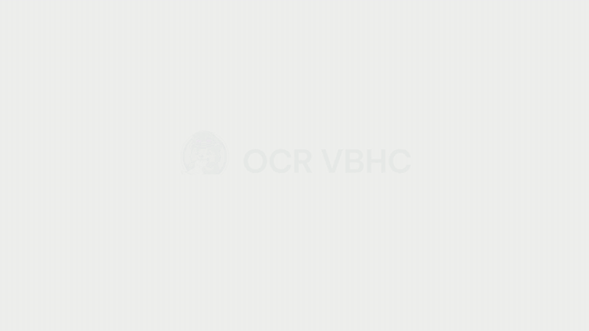

<div align="center">


# OCR VBHC

**Digitise Vietnamese administrative documents and ask questions about them.<br>Every model runs on your own machine, with no Internet connection.**

[](#download-and-run)
[](#your-data-stays-on-the-machine)
[](#for-developers)
[](#running-the-tests)

[Tiếng Việt](README.md) | **English**

<br>

<a href="docs/media/video/pipeline_en.mp4"></a>

<sub>The whole pipeline in 30 seconds, on a fictional document. <a href="docs/media/video/pipeline_en.mp4">Watch the 1080p MP4</a>.</sub>

</div>

<br>

OCR VBHC is a Windows desktop application for Vietnamese administrative documents
(*văn bản hành chính*). It turns scanned PDFs and images into structured text, makes
them searchable, and lets you question them through a **legal assistant** that cites the
exact page behind each answer. The whole pipeline (OCR, embeddings, reranking and answer
generation) runs locally on llama.cpp and PyTorch. Nothing calls the network at runtime,
so documents, the index and conversations stay on the machine.

<table>
<tr>
<td width="33%" valign="top">

**Read**<br>
Chandra OCR 2 turns each scanned page into layout HTML. Broken pages (truncated,
looping, or mixed with the model's reasoning) are caught and read once more.

</td>
<td width="33%" valign="top">

**Understand**<br>
It extracts the 12 fields defined by Decree 30/2020/NĐ-CP. Search is hybrid: keywords,
meaning, and accent-free text. It also records how documents relate: legal basis,
replacement, amendment, repeal.

</td>
<td width="33%" valign="top">

**Answer**<br>
Qwen3 answers with sources [n] that open the right PDF page. Every number, date and
document reference is checked against the sources before it is shown. The assistant
keeps track of the conversation across turns.

</td>
</tr>
</table>

## The interface

<picture>
  <source media="(prefers-color-scheme: dark)" srcset="docs/media/screens/workspace_chat_dark.png">
  
</picture>

<sub>The workspace holds the library, the PDF and the legal assistant. Here the assistant
compares a plan with an earlier submission, and each statement carries its source. Every
document shown belongs to "tỉnh Mẫu", a province that does not exist. The interface is in
Vietnamese, the language of the documents it serves.</sub>

<table>
<tr>
<td width="50%" valign="top">
<picture>
  <source media="(prefers-color-scheme: dark)" srcset="docs/media/screens/home_dark.png">
  
</picture>
<sub><b>Home:</b> a register of recent documents and three ways to add more.</sub>
</td>
<td width="50%" valign="top">
<picture>
  <source media="(prefers-color-scheme: dark)" srcset="docs/media/screens/aisearch_dark.png">
  
</picture>
<sub><b>Smart search:</b> find documents by meaning, not only by exact words.</sub>
</td>
</tr>
<tr>
<td width="50%" valign="top" align="center">
<picture>
  <source media="(prefers-color-scheme: dark)" srcset="docs/media/screens/editor_calendar_dark.png">
  
</picture><br>
<sub><b>Full text and details:</b> edit every Decree 30 field and pick the issue date from a calendar. Each save is a new version.</sub>
</td>
<td width="50%" valign="top" align="center">
<picture>
  <source media="(prefers-color-scheme: dark)" srcset="docs/media/screens/chat_dark.png">
  
</picture><br>
<sub><b>Legal assistant:</b> sources appear as chips that open the right PDF page.</sub>
</td>
</tr>
</table>

The light and dark themes share one palette: olive and gold on neutral paper. Icons come
from Microsoft's Fluent UI System Icons. The interface is set in Be Vietnam Pro, and
document text in Times New Roman, like the originals.

## How it works

### Architecture

<picture>
  <source media="(prefers-color-scheme: dark)" srcset="docs/media/diagrams/architecture_en_dark.svg">
  
</picture>

1. **Input.** One file, many files, or a whole folder of PDFs and images. PDF pages are
   rendered at an adaptive DPI.
2. **OCR.** Chandra OCR 2, a vision-language model (GGUF Q4_K_M), runs on llama.cpp's
   `llama-server`. Each worker owns its own KV slot of 12,288 cells, with thinking turned
   off. The output is layout HTML for every page.
3. **Page check.** Pages that are truncated, looping, missing HTML or mixed with reasoning
   prose are stopped and read once more, one at a time. If a page still fails, its
   reasoning prose and loops are stripped from the text and the page is flagged so the
   user can OCR it again.
4. **Decree 30 fields.** The parser extracts 12 fields: document number, issue date,
   type, issuing body, summary, signer, position, urgency, confidentiality, recipients
   and more. Users can edit every field, and each save creates a new version.
5. **Storage.** SQLite with FTS5 full-text search (plus an accent-folded index for
   queries typed without diacritics) and 1024-dimension `sqlite-vec` vectors. A graph of
   legal relations links the documents.
6. **Retrieval.** The FTS, vector and accent-free FTS lists are merged with RRF. ViRanker
   rescores the candidate passages, and a relevance gate drops the ones that do not fit.
7. **Answer.** Qwen3 receives the question with the chosen passages. Its answer is
   checked before the user sees it.

### How the models work together

<picture>
  <source media="(prefers-color-scheme: dark)" srcset="docs/media/diagrams/models_en_dark.svg">
  
</picture>

| Role | Model | Runs on | Size |
|---|---|---|---|
| OCR | [Chandra OCR 2](https://github.com/datalab-to/chandra), Q4_K_M + mmproj Q8_0 | `llama-server`, port 9999 | 2.9 GB + 349 MB |
| Embeddings | [AITeamVN/Vietnamese_Embedding](https://huggingface.co/AITeamVN/Vietnamese_Embedding) (bge-m3, 1024-dim) | PyTorch | ~2.2 GB |
| Reranking | [namdp-ptit/ViRanker](https://huggingface.co/namdp-ptit/ViRanker) (0.6B cross-encoder) | PyTorch, CPU | ~1.5 GB |
| Assistant | [Qwen3-8B](https://huggingface.co/Qwen/Qwen3-8B) or [Qwen3-4B-Instruct-2507](https://huggingface.co/Qwen/Qwen3-4B-Instruct-2507), Q4_K_M | `llama-server`, port 9998 | 5.0 / 2.5 GB |

The application picks its setup from the hardware:

- **Assistant model.** Qwen3-8B when the GPU has at least 10 GB of free VRAM, Qwen3-4B
  from 5 GB. Without a GPU, Qwen3-4B runs on the CPU with an 8k context.
- **OCR workers.** One on CPU. One on GPUs up to 12 GB, two from 16 GB, four from 48 GB.
  Chandra uses about 3.5 GB of VRAM.

### The legal assistant

<picture>
  <source media="(prefers-color-scheme: dark)" srcset="docs/media/diagrams/chat_en_dark.svg">
  
</picture>

- **Conversation memory.** Each turn records the open document and the documents
  mentioned or cited. The next turn receives a compact "conversation state" block. The
  document resolver understands full and bare document numbers, numbers the OCR misread,
  and phrases such as "the previous document", "the first one", "both", or "that
  submission". Questions about the conversation itself are answered from its history,
  with no new search.
- **Statistics computed in code.** Questions like "who signed the most" or "how many
  plans in 2026" are counted from the metadata tables, not by the model.
- **Multi-document comparison.** The app preloads sources for every document the
  question mentions. The model also has tools: search, document details, related
  documents, validity, reading a section, and listing.
- **Answer check.** Every document number, date, figure, count and "type + number" pair
  in an answer is matched against the sources. If something does not match, the model
  gets one chance to correct it. Anything still missing from the sources is removed or
  marked "(chưa xác minh)", unverified.

<div align="center">
<a href="docs/media/video/memory_en.mp4"></a><br>
<sub>The conversation state resolves "that submission" and "the start of the chat" to the right documents.</sub>
</div>

## Measured accuracy

All figures below were measured on the developer's machine (RTX 5090 Laptop, 24 GB,
Qwen3-8B) with local test sets. The test sets contain real documents and are not
published. Results on other hardware will differ.

<picture>
  <source media="(prefers-color-scheme: dark)" srcset="docs/media/charts/capabilities_en_dark.svg">
  
</picture>

<table>
<tr>
<td width="50%">
<picture>
  <source media="(prefers-color-scheme: dark)" srcset="docs/media/charts/ocr_quality_en_dark.svg">
  
</picture>
</td>
<td width="50%">
<picture>
  <source media="(prefers-color-scheme: dark)" srcset="docs/media/charts/rag_single_turn_en_dark.svg">
  
</picture>
</td>
</tr>
</table>

<picture>
  <source media="(prefers-color-scheme: dark)" srcset="docs/media/charts/multiturn_en_dark.svg">
  
</picture>

| Measure | Before | Now |
|---|---:|---:|
| Decree 30 fields extracted correctly (50 pages, 165 fields) | | **133/165** (80.6%) |
| Character error rate, CER (7 pages with a reference text) | 1.65% | **0.74%** |
| Truncated pages | 1 | **0** |
| OCR server RAM | 15.5 GB | **6.2 GB** |
| Single-turn questions (41 with known answers) | 13/41 | **36–38/41** |
| Multi-turn conversations (52 conversations, 199 turns) | 134/199 | **187/199** (94%) |
| Conversations fully correct | 16/52 | **40/52** |
| First turn's document still recalled at turn 4 or later | 3/16 | **16/16** |
| Comparison questions | 5/22 | **18/22** |
| False "not found" answers | 25 | **8** |
| Real-data set (24 conversations, 67 turns, 26 documents) | 41/67 | **65/67** |
| Answers with a figure not found in the sources | 17 | **0** |

On speed:

- **Assistant.** About 5.6 s per turn on average. Questions about the conversation
  itself take about 0.8 s, and the answer check takes about 2 ms.
- **OCR.** About 7.8 s per page with two workers on an idle GPU, 17–25 s per page with
  one worker on a shared GPU, and about 90 s per page on CPU only.

Single-turn results vary by ±1 question from run to run.

## Recommended hardware

<picture>
  <source media="(prefers-color-scheme: dark)" srcset="docs/media/diagrams/hardware_en_dark.svg">
  
</picture>

<details>
<summary>The same table as text</summary>

| | Minimum (CPU) | Recommended | Best |
|---|---|---|---|
| OS | Windows 10/11 x64 | Windows 11 x64 | Windows 11 x64 |
| GPU | Not needed. OCR about 90 s/page, Qwen3-4B with 8k context | NVIDIA, 8 GB or more: Qwen3-4B, 1 OCR worker | NVIDIA, 16–24 GB: Qwen3-8B, 2 OCR workers |
| RAM | 16 GB | 32 GB | 32–64 GB |
| Disk | About 25 GB free | SSD | NVMe SSD |

The recommended tier's OCR speed of about 20 s/page was measured on an RTX 4070 8 GB
(April 2026, before the October fixes).

</details>

## Download and run

### For users

A working installation has three layers, and only the source layer lives in Git:

| Layer | Contents | Size |
|---|---|---|
| Source | This repository | Small |
| Runtime | Embedded Python 3.9 with PyQt5, PyTorch and the rest (`runtime/`) | ~5 GB |
| Models and tools | `gguf/`, `model_embedding/`, `model_reranker/`, `bin/` (llama.cpp), `tools/poppler/` | ~16 GB |

1. **Get the full package.** `OCR_VBHC_Portable` comes on a USB drive or an internal
   network share. When a release is tagged `v*`, GitHub Releases publishes the runtime
   layer as `.part` files with `SHA256SUMS` and `BUILD_MANIFEST.json`. The model layer
   travels separately as an asset bundle, packed and verified by `build_asset_bundle.py`.
2. **Copy the whole folder** to an SSD. Do not copy files one by one: the relative paths
   need the full folder structure.
3. **Run `verify.bat` once** to check that the package is complete and laid out
   correctly.
4. **Double-click `start.bat`.** It finds the embedded Python, detects the GPU and picks
   the CUDA or CPU build of `llama-server`. The first start takes about 30–60 s while
   the models load.
5. **Start working.** On the home page, choose *Quét một văn bản* (scan one document),
   *Thêm nhiều tệp* (add several files) or *Nhập thư mục văn bản* (import a folder), then
   ask the *Trợ lý pháp luật* (legal assistant). A long import saves each document as
   soon as it is done, so you can stop and resume.

To update, run `CAP_NHAT.bat "<patch folder>"`. The patch folder must hold
`BUILD_MANIFEST.json` and `SHA256SUMS`, and only files that match their checksums are
installed. The operator guide and troubleshooting notes (in Vietnamese) are in
[PORTABLE_README.md](PORTABLE_README.md).

### From source

```bash
git clone https://github.com/manh2303code/ocr-vbhc.git
```

Copy the heavy folders (`runtime/`, `bin/`, `gguf/`, `model_embedding/`,
`model_reranker/`, `tools/poppler/`) from a full package into the clone, then run
`start.bat`. To rebuild the whole portable package, use `build_portable.py`. See
[For developers](#for-developers) below.

## Your data stays on the machine

- All four models run locally, and both llama.cpp servers listen on `127.0.0.1` only.
- `tools/check_airgap.py` audits every TCP connection of the running app and fails if
  any of them leaves the machine. `tests/test_airgap.py` tests that audit.
- Documents, the index, edit history and conversations all live in SQLite under
  `database/`. Moving to another machine means copying the folder.
- The assistant's answers are for reference only and do not replace professional legal
  advice.

> [!NOTE]
> Every screenshot, video and diagram in this README was made from fictional documents
> ([`devtools/demo_corpus/`](devtools/demo_corpus)). The repository contains no real
> documents.

## For developers

### Requirements

| Component | Version |
|---|---|
| Python | 3.9 (embedded runtime in `runtime/`) |
| Qt | PyQt5 5.15.11 + PyQtWebEngine 5.15.7 |
| OCR | Chandra OCR 2 Q4_K_M on llama.cpp (port 9999) |
| Assistant | Qwen3 4B/8B Q4_K_M on llama.cpp (port 9998) |
| OS | Windows 10/11 x64 |

### Module map

**Startup and application shell**
- `main.py`: entry point, loads fonts, creates the `AppController`
- `startup_controller.py`: moves between the light home page and the heavy workspace
- `landing_page.py`, `landing_data.py`: the home page (WebEngine, with a plain-Qt fallback)
- `frontend/landing/`: the home page's HTML, CSS and JS, all loaded locally

**Working interface**
- `main_window_1.py`: main window, editor, PDF viewer
- `ui_commands.py`: the single command catalogue behind the toolbar, command palette and shortcut sheet
- `workspace_layout.py`: column layout rules as pure functions, with their own tests
- `chat_panel.py`, `analytics_dialog.py`, `ai_search_dialog.py`, `settings_dialog.py`

**Design system**
- `theme_tokens.py`: colours, spacing, radii and typography for both themes
- `devtools/theme_template.qss` → `devtools/build_qss.py` → `theme.qss` / `theme_dark.qss`
- `ui_icons.py` + `icons/fluent/`: loads the Fluent UI System Icons SVGs, tints them and caches them as `QIcon`s
- `font_loader.py` + `assets/fonts/`: registers Be Vietnam Pro before any widget exists

**Data processing**
- `ocr_pipeline.py`, `llama_ocr.py`, `chandra_field_parser.py`: OCR, the page check, field extraction
- `document_repository.py`: SQLite, versions, backups
- `vector_index.py`, `search_store.py`, `retrieval.py`, `reranker.py`: hybrid search
- `rag_agent.py`, `agent_tools.py`, `llm_client.py`: the agent loop that answers with sources
- `doc_resolver.py`, `metadata_query.py`, `answer_check.py`: reference resolution, statistics in code, answer checking
- `background_workers.py`: the shared `QThread` workers

### Running the tests

The embedded runtime does not ship `pytest`. Install it into a separate folder so the
portable package stays clean:

```bash
runtime/python.exe -m pip install --target .devtools pytest
```

The embedded Python has a `python39._pth` file, so it ignores `PYTHONPATH`. Load the
folder above with a small bootstrap instead:

```bash
runtime/python.exe -c "import sys,os; sys.path.insert(0,'.devtools'); os.environ['QT_QPA_PLATFORM']='offscreen'; import pytest; sys.exit(pytest.console_main())" tests/ -q
```

Some tests skip themselves when the GGUF models or a real corpus are missing.

### CI on Linux

The whole suite runs on Linux in Docker, without any model:

```bash
docker build -f docker/Dockerfile.ci -t ocr-vbhc-ci . && docker run --rm ocr-vbhc-ci
```

The image holds only the source and pins Python 3.9 and PyTorch 2.8 CPU, matching
`build_portable.PYTHON_VERSION` and `TORCH_VERSION`. PyQtWebEngine is left out on
purpose: `landing_page.py` guards the import and `tests/test_landing.py` runs the
fallback path. The image is for testing only, not for running the application.
`.github/workflows/ci.yml` runs the suite on every push, and `release.yml` builds the
runtime layer for `v*` tags.

### Architecture constraints

- `tests/test_architecture_boundaries.py` keeps `main_window_1.py` from growing back
  into a god object.
- `tests/test_portable_manifest.py` makes sure every new file is packaged by
  `build_portable.py` and checked by `verify.bat`.
- `tests/test_qss_generated.py` makes sure the stylesheets are always generated from
  the tokens, never edited by hand.

### Contribution conventions

- A new source file goes into `CORE_PY_FILES` or `STATIC_FILES` in `build_portable.py`,
  and into `verify.bat`.
- A new colour goes into `theme_tokens.py`; widgets never hard-code hex values.
- A new command or shortcut goes into `ui_commands.COMMANDS`.
- Keep the code Python 3.9 compatible: no `match`, no `X | Y` at runtime.
- Measure large changes first: keep the old configuration, run an A/B comparison, and
  merge only when the result is better.

### Rebuilding the README visuals

| Folder | Contents | Command |
|---|---|---|
| `devtools/demo_corpus/` | 10 fictional Decree 30 documents and the demo database | `runtime\python.exe -X utf8 devtools\demo_corpus\build_demo.py all <demo.db>` |
| `devtools/readme_shots.py` | Screenshots of the real app on the demo data | `runtime\python.exe -X utf8 devtools\readme_shots.py <demo.db> docs\media\screens` |
| `docs/readme-src/` | Animated SVG diagrams and charts (Node) | `node docs/readme-src/build.mjs` |
| `docs/video/` | Remotion videos (VI/EN) | `npm ci && npm run render` |

## Developer

<table>
<tr>
<td></td>
<td>

**Trần Hậu Mạnh** ([@manh2303code](https://github.com/manh2303code)) developed OCR VBHC:
the OCR pipeline and the Decree 30 field parser, hybrid search, the legal assistant and
its test benches, and the application's interface.

</td>
</tr>
</table>

## Credits and third-party licences

- [llama.cpp](https://github.com/ggml-org/llama.cpp) serves Chandra OCR 2 and Qwen3.
- The models [Chandra OCR 2](https://github.com/datalab-to/chandra) (Datalab),
  [Qwen3](https://github.com/QwenLM/Qwen3) (Qwen),
  [Vietnamese_Embedding](https://huggingface.co/AITeamVN/Vietnamese_Embedding) (AITeamVN)
  and [ViRanker](https://huggingface.co/namdp-ptit/ViRanker) are used under the licences
  on their own pages.
- Be Vietnam Pro (SIL OFL 1.1) and Microsoft's Fluent UI System Icons (MIT): see
  [THIRD_PARTY_NOTICES.md](THIRD_PARTY_NOTICES.md).
- The videos are made with [Remotion](https://www.remotion.dev). Their source is in
  `docs/video/`, with a note on Remotion's licence.
