<div align="center">

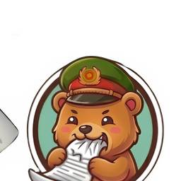

# OCR VBHC

**Số hóa và hỏi đáp văn bản hành chính tiếng Việt.<br>Mọi model chạy ngay trên máy, không cần Internet.**

[](#tải-và-chạy)
[](#dữ-liệu-ở-yên-trên-máy)
[](#dành-cho-nhà-phát-triển)
[](#chạy-test)

**Tiếng Việt** | [English](README.en.md)

<br>

<a href="docs/media/video/pipeline_vi.mp4">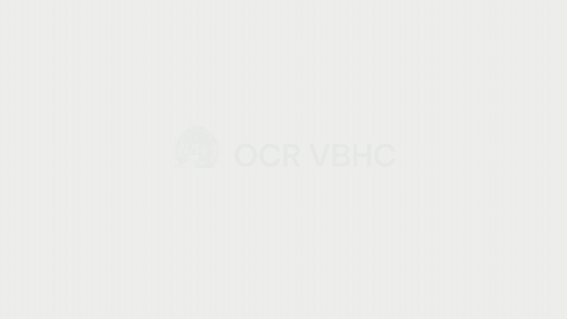</a>

<sub>30 giây cho cả pipeline, trên một văn bản giả lập. <a href="docs/media/video/pipeline_vi.mp4">Xem bản MP4 1080p</a>.</sub>

</div>

<br>

OCR VBHC là ứng dụng desktop cho Windows. Ứng dụng biến bản quét PDF hoặc ảnh của
văn bản hành chính thành văn bản có cấu trúc, cho phép tra cứu toàn văn và hỏi đáp với
một **trợ lý pháp luật** trả lời kèm trích dẫn tới đúng trang. Cả pipeline (OCR,
embedding, rerank, sinh câu trả lời) chạy cục bộ bằng llama.cpp và PyTorch. Lúc chạy
không có lệnh gọi mạng nào, nên văn bản, chỉ mục và hội thoại luôn nằm trên máy.

<table>
<tr>
<td width="33%" valign="top">

**Đọc**<br>
Chandra OCR 2 đọc bản quét thành HTML theo đúng bố cục. Trang lỗi (cắt cụt, lặp vòng,
lẫn lời suy luận của model) bị chặn lại và đọc lại một lần.

</td>
<td width="33%" valign="top">

**Hiểu**<br>
Bóc tách 12 trường theo Nghị định 30/2020/NĐ-CP. Tìm kiếm lai giữa từ khóa, ngữ nghĩa
và chữ không dấu. Lưu quan hệ căn cứ, thay thế, sửa đổi, bãi bỏ giữa các văn bản.

</td>
<td width="33%" valign="top">

**Trả lời**<br>
Qwen3 trả lời kèm nguồn [n], bấm vào là mở đúng trang PDF. Mọi số, ngày và số hiệu
được đối chiếu với nguồn trước khi hiển thị. Trợ lý nhớ ngữ cảnh qua nhiều lượt hỏi.

</td>
</tr>
</table>

## Giao diện

<picture>
  <source media="(prefers-color-scheme: dark)" srcset="docs/media/screens/workspace_chat_dark.png">
  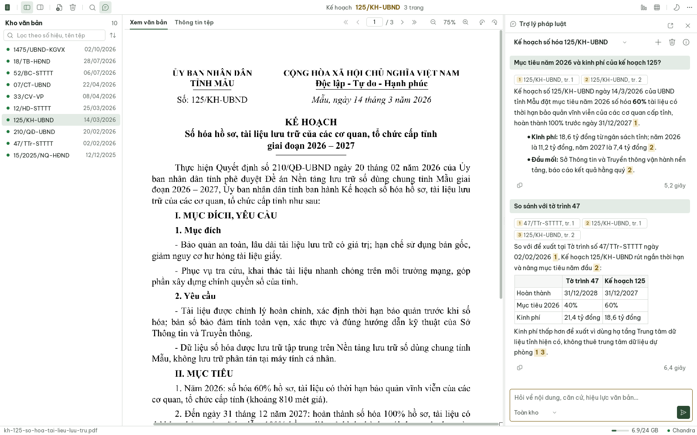
</picture>

<sub>Không gian làm việc gồm kho văn bản, bản PDF và trợ lý pháp luật. Trợ lý đang so sánh
một kế hoạch với tờ trình trước đó, và mỗi nhận định đều có nguồn. Mọi văn bản trong
ảnh là văn bản giả lập của "tỉnh Mẫu", một tỉnh không có thật.</sub>

<table>
<tr>
<td width="50%" valign="top">
<picture>
  <source media="(prefers-color-scheme: dark)" srcset="docs/media/screens/home_dark.png">
  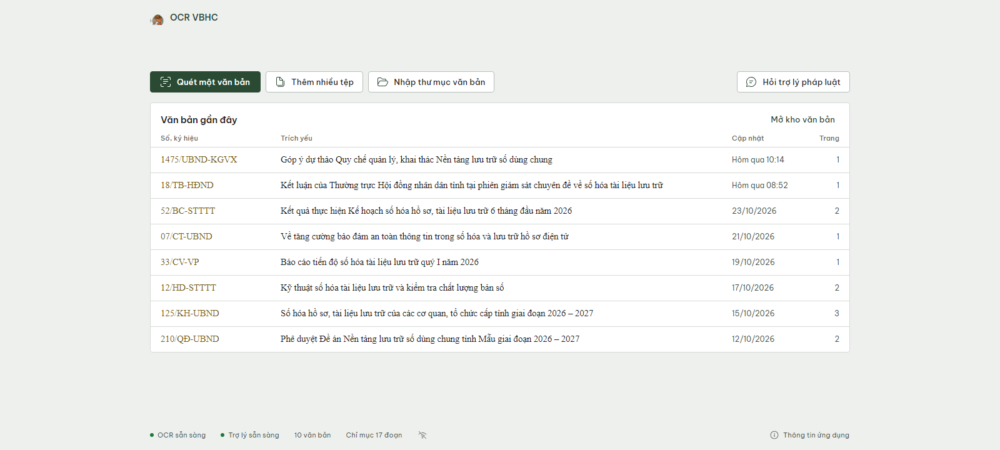
</picture>
<sub><b>Trang chủ:</b> sổ văn bản gần đây và ba cách đưa văn bản vào kho.</sub>
</td>
<td width="50%" valign="top">
<picture>
  <source media="(prefers-color-scheme: dark)" srcset="docs/media/screens/aisearch_dark.png">
  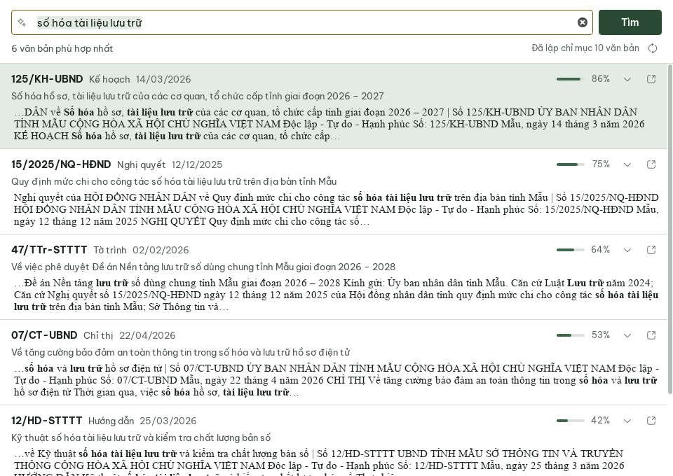
</picture>
<sub><b>Tìm kiếm thông minh:</b> tìm theo ý, không cần gõ đúng từ trong văn bản.</sub>
</td>
</tr>
<tr>
<td width="50%" valign="top" align="center">
<picture>
  <source media="(prefers-color-scheme: dark)" srcset="docs/media/screens/editor_calendar_dark.png">
  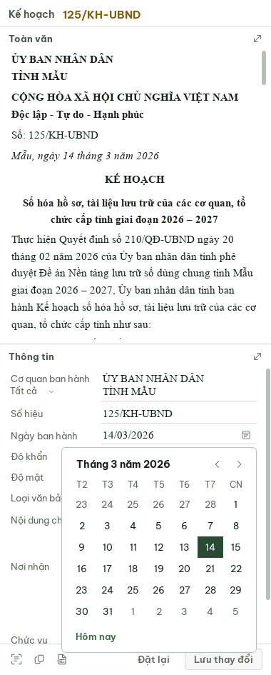
</picture><br>
<sub><b>Toàn văn và Thông tin:</b> sửa từng trường NĐ30, chọn ngày ban hành bằng lịch, mỗi lần lưu là một phiên bản.</sub>
</td>
<td width="50%" valign="top" align="center">
<picture>
  <source media="(prefers-color-scheme: dark)" srcset="docs/media/screens/chat_dark.png">
  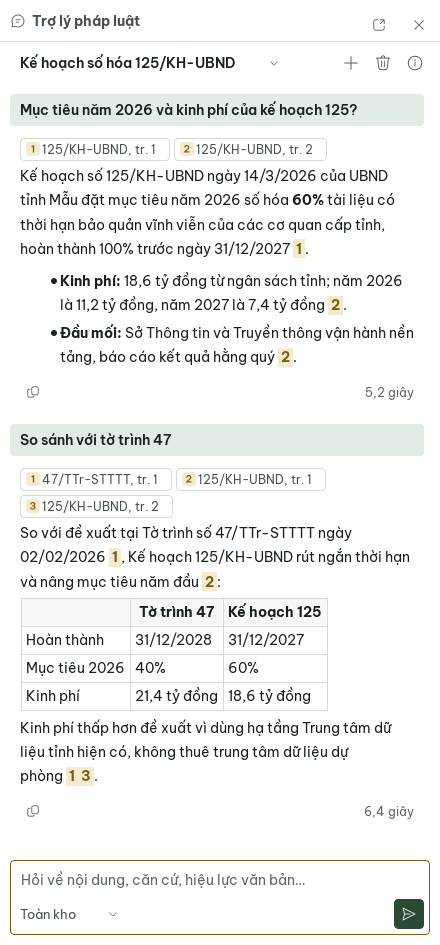
</picture><br>
<sub><b>Trợ lý pháp luật:</b> nguồn hiện thành chip, bấm vào là mở đúng trang PDF.</sub>
</td>
</tr>
</table>

Hai giao diện sáng và tối dùng chung một bảng màu xanh ô liu và vàng trên nền giấy trung
tính. Biểu tượng lấy từ bộ Fluent UI System Icons, chữ giao diện dùng Be Vietnam Pro,
còn nội dung văn bản hiển thị bằng Times New Roman như bản gốc.

## Cách hoạt động

### Kiến trúc

<picture>
  <source media="(prefers-color-scheme: dark)" srcset="docs/media/diagrams/architecture_vi_dark.svg">
  
</picture>

1. **Đầu vào.** Nhận một tệp, nhiều tệp hoặc cả thư mục PDF/ảnh. Trang PDF được dựng
   thành ảnh với DPI thích ứng.
2. **OCR.** Chandra OCR 2 (vision-language model, GGUF Q4_K_M) chạy trên `llama-server`
   của llama.cpp. Mỗi worker giữ một KV slot riêng (12 288 ô ngữ cảnh) và tắt chế độ
   thinking. Kết quả là HTML bố cục cho từng trang.
3. **Cửa kiểm tra trang.** Trang bị cắt cụt, lặp vòng, không có HTML hoặc lẫn lời suy
   luận bị chặn lại và đọc lại tuần tự một lần. Nếu vẫn lỗi, lời suy luận và đoạn lặp
   bị loại khỏi văn bản, còn trang đó được đánh dấu để người dùng OCR lại.
4. **Bóc tách trường NĐ30.** Gồm 12 trường: số ký hiệu, ngày ban hành, loại văn bản, cơ
   quan ban hành, trích yếu, người ký, chức vụ, độ khẩn, độ mật, nơi nhận… Người dùng
   sửa được mọi trường và mỗi lần lưu tạo một phiên bản mới.
5. **Lưu trữ.** Dùng SQLite với chỉ mục toàn văn FTS5 (kèm một chỉ mục bỏ dấu cho câu hỏi
   gõ không dấu) và vector `sqlite-vec` 1024 chiều. Bên cạnh đó là đồ thị quan hệ pháp lý
   giữa các văn bản.
6. **Truy hồi.** Ba danh sách FTS, vector và FTS không dấu được trộn bằng RRF. ViRanker
   chấm lại các đoạn ứng viên, rồi một ngưỡng liên quan loại những đoạn không đủ khớp.
7. **Trả lời.** Qwen3 nhận câu hỏi cùng các đoạn nguồn đã chọn. Câu trả lời đi qua bước
   kiểm tra trước khi tới người dùng.

### Các model phối hợp

<picture>
  <source media="(prefers-color-scheme: dark)" srcset="docs/media/diagrams/models_vi_dark.svg">
  
</picture>

| Vai trò | Model | Chạy bằng | Dung lượng |
|---|---|---|---|
| OCR | [Chandra OCR 2](https://github.com/datalab-to/chandra), Q4_K_M + mmproj Q8_0 | `llama-server`, cổng 9999 | 2,9 GB + 349 MB |
| Embedding | [AITeamVN/Vietnamese_Embedding](https://huggingface.co/AITeamVN/Vietnamese_Embedding) (bge-m3, 1024 chiều) | PyTorch | ~2,2 GB |
| Rerank | [namdp-ptit/ViRanker](https://huggingface.co/namdp-ptit/ViRanker) (cross-encoder 0,6B) | PyTorch, CPU | ~1,5 GB |
| Trợ lý | [Qwen3-8B](https://huggingface.co/Qwen/Qwen3-8B) hoặc [Qwen3-4B-Instruct-2507](https://huggingface.co/Qwen/Qwen3-4B-Instruct-2507), Q4_K_M | `llama-server`, cổng 9998 | 5,0 / 2,5 GB |

Ứng dụng tự chọn cấu hình theo phần cứng:

- **Model trợ lý.** Dùng Qwen3-8B khi GPU còn từ 10 GB VRAM, Qwen3-4B khi còn từ 5 GB.
  Nếu không có GPU, Qwen3-4B chạy trên CPU với ngữ cảnh 8k.
- **Số worker OCR.** CPU dùng 1 worker. GPU tới 12 GB dùng 1 worker, từ 16 GB dùng 2,
  từ 48 GB dùng 4. Chandra chiếm khoảng 3,5 GB VRAM.

### Trợ lý pháp luật

<picture>
  <source media="(prefers-color-scheme: dark)" srcset="docs/media/diagrams/chat_vi_dark.svg">
  
</picture>

- **Nhớ hội thoại.** Mỗi lượt lưu lại văn bản đang mở và các văn bản đã nhắc tới hoặc
  đã trích dẫn. Lượt sau nhận một khối "trạng thái hội thoại" gọn. Bộ giải nghĩa tham
  chiếu hiểu số hiệu đầy đủ hay rút gọn, số hiệu bị OCR đọc sai, và các cách nói như
  "văn bản trước", "văn bản đầu tiên", "cả hai", "tờ trình đó". Câu hỏi về chính cuộc
  hội thoại được trả lời từ lịch sử, không cần tìm lại.
- **Thống kê tính bằng mã.** Các câu như "ai ký nhiều nhất", "bao nhiêu kế hoạch năm
  2026" được đếm thẳng từ bảng metadata, không để model tự đếm.
- **So sánh nhiều văn bản.** Ứng dụng nạp sẵn nguồn của mọi văn bản được nhắc tới. Model
  còn có các công cụ: tìm kiếm, xem thông tin văn bản, văn bản liên quan, hiệu lực, đọc
  một mục và liệt kê.
- **Kiểm tra câu trả lời.** Mọi số hiệu, ngày, con số, số đếm và cặp "loại + số" trong
  câu trả lời đều được đối chiếu với nguồn. Nếu có sai lệch, model được yêu cầu sửa
  một lần. Chi tiết nào vẫn không có trong nguồn sẽ bị bỏ hoặc gắn nhãn "(chưa xác minh)".

<div align="center">
<a href="docs/media/video/memory_vi.mp4">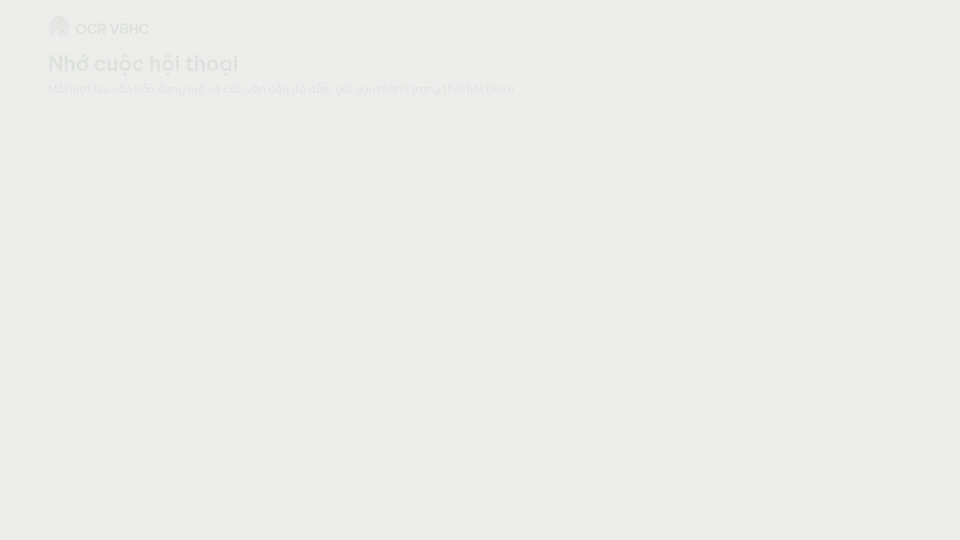</a><br>
<sub>Tham chiếu "tờ trình đó" và "đầu đoạn chat" được giải ra đúng văn bản nhờ trạng thái hội thoại.</sub>
</div>

## Độ chính xác đo được

Mọi con số dưới đây được đo trên máy của người phát triển (RTX 5090 Laptop 24 GB,
Qwen3-8B) với các bộ test cục bộ. Các bộ test này chứa văn bản thật nên không được công
bố. Trên máy khác, kết quả có thể khác.

<picture>
  <source media="(prefers-color-scheme: dark)" srcset="docs/media/charts/capabilities_vi_dark.svg">
  
</picture>

<table>
<tr>
<td width="50%">
<picture>
  <source media="(prefers-color-scheme: dark)" srcset="docs/media/charts/ocr_quality_vi_dark.svg">
  
</picture>
</td>
<td width="50%">
<picture>
  <source media="(prefers-color-scheme: dark)" srcset="docs/media/charts/rag_single_turn_vi_dark.svg">
  
</picture>
</td>
</tr>
</table>

<picture>
  <source media="(prefers-color-scheme: dark)" srcset="docs/media/charts/multiturn_vi_dark.svg">
  
</picture>

| Hạng mục | Trước | Hiện tại |
|---|---:|---:|
| Trường NĐ30 bóc đúng (50 trang, 165 trường) | | **133/165** (80,6%) |
| Tỉ lệ lỗi ký tự, CER (7 trang có bản chuẩn) | 1,65% | **0,74%** |
| Trang bị cắt cụt | 1 | **0** |
| RAM của máy chủ OCR | 15,5 GB | **6,2 GB** |
| Hỏi đáp một lượt (41 câu có đáp án) | 13/41 | **36–38/41** |
| Hội thoại nhiều lượt (52 hội thoại, 199 lượt) | 134/199 | **187/199** (94%) |
| Hội thoại đúng trọn vẹn | 16/52 | **40/52** |
| Nhớ văn bản của lượt đầu khi đã tới lượt 4 trở đi | 3/16 | **16/16** |
| Câu hỏi so sánh văn bản | 5/22 | **18/22** |
| Báo nhầm "không tìm thấy" | 25 | **8** |
| Bộ dữ liệu thật (24 hội thoại, 67 lượt, 26 văn bản) | 41/67 | **65/67** |
| Câu trả lời có số liệu không có trong nguồn | 17 | **0** |

Về tốc độ:

- **Trợ lý.** Trung bình khoảng 5,6 giây mỗi lượt. Câu hỏi về chính cuộc hội thoại mất
  khoảng 0,8 giây, còn bước kiểm tra câu trả lời chỉ tốn khoảng 2 ms.
- **OCR.** Khoảng 7,8 giây mỗi trang với 2 worker trên GPU rảnh, 17–25 giây mỗi trang
  với 1 worker trên GPU dùng chung, và khoảng 90 giây mỗi trang nếu chỉ có CPU.

Kết quả hỏi đáp một lượt dao động ±1 câu giữa các lần chạy.

## Cấu hình đề xuất

<picture>
  <source media="(prefers-color-scheme: dark)" srcset="docs/media/diagrams/hardware_vi_dark.svg">
  
</picture>

<details>
<summary>Bảng cấu hình dạng chữ</summary>

| | Tối thiểu (CPU) | Đề xuất | Tốt nhất |
|---|---|---|---|
| Hệ điều hành | Windows 10/11 x64 | Windows 11 x64 | Windows 11 x64 |
| GPU | Không cần. OCR khoảng 90 giây/trang, Qwen3-4B ngữ cảnh 8k | NVIDIA từ 8 GB: Qwen3-4B, 1 worker OCR | NVIDIA 16–24 GB: Qwen3-8B, 2 worker OCR |
| RAM | 16 GB | 32 GB | 32–64 GB |
| Ổ đĩa | Trống khoảng 25 GB | SSD | NVMe SSD |

Tốc độ OCR khoảng 20 giây/trang ở mức đề xuất được đo trên RTX 4070 8 GB (tháng 4/2026,
trước các bản sửa tháng 10).

</details>

## Tải và chạy

### Người dùng

Một bộ cài chạy được gồm ba tầng, và chỉ tầng mã nguồn nằm trong Git:

| Tầng | Nội dung | Dung lượng |
|---|---|---|
| Mã nguồn | Repo này | Nhỏ |
| Runtime | Python 3.9 nhúng cùng PyQt5, PyTorch… (`runtime/`) | ~5 GB |
| Model và công cụ | `gguf/`, `model_embedding/`, `model_reranker/`, `bin/` (llama.cpp), `tools/poppler/` | ~16 GB |

1. **Lấy gói đầy đủ** `OCR_VBHC_Portable` qua USB hoặc ổ mạng nội bộ. Khi có bản phát
   hành gắn tag `v*`, GitHub Releases đăng tầng runtime dưới dạng các tệp `.part` kèm
   `SHA256SUMS` và `BUILD_MANIFEST.json`. Tầng model đi riêng thành một gói asset do
   `build_asset_bundle.py` đóng gói và kiểm tra.
2. **Chép nguyên thư mục** vào ổ SSD. Không chép lẻ từng tệp, vì các đường dẫn tương đối
   cần đủ cấu trúc thư mục.
3. **Chạy `verify.bat` một lần** để kiểm tra gói có đủ tệp và đúng cấu trúc.
4. **Nhấp đúp `start.bat`.** Script tự tìm Python nhúng, phát hiện GPU và chọn
   `llama-server` bản CUDA hoặc CPU. Lần đầu mất khoảng 30–60 giây để nạp model.
5. **Bắt đầu dùng.** Ở trang chủ, chọn *Quét một văn bản*, *Thêm nhiều tệp* hoặc *Nhập
   thư mục văn bản*, rồi đặt câu hỏi cho *Trợ lý pháp luật*. Một đợt nhập dài lưu từng
   văn bản ngay khi xong, nên có thể dừng giữa chừng rồi chạy tiếp.

Muốn cập nhật thì chạy `CAP_NHAT.bat "<thư mục bản vá>"`. Bản vá phải có
`BUILD_MANIFEST.json` và `SHA256SUMS`, và chỉ những tệp đã khớp checksum mới được cài.
Hướng dẫn vận hành và xử lý sự cố nằm ở [PORTABLE_README.md](PORTABLE_README.md).

### Từ mã nguồn

```bash
git clone https://github.com/manh2303code/ocr-vbhc.git
```

Chép các thư mục nặng (`runtime/`, `bin/`, `gguf/`, `model_embedding/`,
`model_reranker/`, `tools/poppler/`) từ một gói đầy đủ vào thư mục vừa clone, rồi chạy
`start.bat`. Muốn dựng lại cả gói portable thì dùng `build_portable.py`. Xem phần
[Dành cho nhà phát triển](#dành-cho-nhà-phát-triển).

## Dữ liệu ở yên trên máy

- Cả bốn model chạy cục bộ. Hai máy chủ llama.cpp chỉ lắng nghe trên `127.0.0.1`.
- `tools/check_airgap.py` kiểm tra mọi kết nối TCP của ứng dụng đang chạy và báo lỗi khi
  có kết nối nào đi ra ngoài máy. Công cụ này được kiểm thử trong `tests/test_airgap.py`.
- Văn bản, chỉ mục, phiên bản chỉnh sửa và lịch sử hội thoại đều nằm trong SQLite ở
  `database/`. Chuyển máy chỉ cần chép thư mục.
- Câu trả lời của trợ lý chỉ để tham khảo, không thay thế ý kiến pháp lý chuyên môn.

> [!NOTE]
> Mọi ảnh chụp, video và sơ đồ trong README này đều dựng từ văn bản giả lập
> ([`devtools/demo_corpus/`](devtools/demo_corpus)). Không có văn bản thật nào trong repo.

## Dành cho nhà phát triển

### Yêu cầu

| Thành phần | Phiên bản |
|---|---|
| Python | 3.9 (runtime nhúng trong `runtime/`) |
| Qt | PyQt5 5.15.11 + PyQtWebEngine 5.15.7 |
| OCR | Chandra OCR 2 Q4_K_M qua llama.cpp (cổng 9999) |
| Trợ lý | Qwen3 4B/8B Q4_K_M qua llama.cpp (cổng 9998) |
| Hệ điều hành | Windows 10/11 x64 |

### Bản đồ module

**Khởi động và vỏ ứng dụng**
- `main.py`: điểm vào, nạp font, tạo `AppController`
- `startup_controller.py`: điều phối trang chủ nhẹ và workspace nặng
- `landing_page.py`, `landing_data.py`: trang chủ (WebEngine, có phương án dự phòng bằng Qt thuần)
- `frontend/landing/`: HTML/CSS/JS của trang chủ, chỉ nạp tài nguyên cục bộ

**Giao diện nghiệp vụ**
- `main_window_1.py`: cửa sổ chính, editor, trình xem PDF
- `ui_commands.py`: danh mục lệnh duy nhất cho toolbar, command palette và bảng phím tắt
- `workspace_layout.py`: quy tắc chia cột viết thành hàm thuần, có test riêng
- `chat_panel.py`, `analytics_dialog.py`, `ai_search_dialog.py`, `settings_dialog.py`

**Hệ thống thiết kế**
- `theme_tokens.py`: bảng màu, spacing, radius, typography cho cả hai giao diện
- `devtools/theme_template.qss` → `devtools/build_qss.py` → `theme.qss` / `theme_dark.qss`
- `ui_icons.py` + `icons/fluent/`: nạp SVG Fluent UI System Icons, tô màu và cache thành `QIcon`
- `font_loader.py` + `assets/fonts/`: đăng ký Be Vietnam Pro trước khi tạo widget

**Xử lý dữ liệu**
- `ocr_pipeline.py`, `llama_ocr.py`, `chandra_field_parser.py`: OCR, cửa kiểm tra trang, bóc tách trường
- `document_repository.py`: SQLite, phiên bản, sao lưu
- `vector_index.py`, `search_store.py`, `retrieval.py`, `reranker.py`: tìm kiếm lai
- `rag_agent.py`, `agent_tools.py`, `llm_client.py`: vòng lặp agent trả lời có dẫn nguồn
- `doc_resolver.py`, `metadata_query.py`, `answer_check.py`: giải tham chiếu, thống kê bằng mã, kiểm tra câu trả lời
- `background_workers.py`: các `QThread` dùng chung

### Chạy test

Runtime nhúng không kèm `pytest`. Hãy cài vào một thư mục riêng để không làm bẩn gói
portable:

```bash
runtime/python.exe -m pip install --target .devtools pytest
```

Bản Python nhúng có `python39._pth` nên bỏ qua biến `PYTHONPATH`. Vì vậy cần nạp thư mục
trên bằng một script mồi:

```bash
runtime/python.exe -c "import sys,os; sys.path.insert(0,'.devtools'); os.environ['QT_QPA_PLATFORM']='offscreen'; import pytest; sys.exit(pytest.console_main())" tests/ -q
```

Một số test tự bỏ qua khi thiếu model GGUF hoặc corpus thật.

### CI trên Linux

Toàn bộ test chạy được trên Linux trong Docker mà không cần model:

```bash
docker build -f docker/Dockerfile.ci -t ocr-vbhc-ci . && docker run --rm ocr-vbhc-ci
```

Image chỉ chứa mã nguồn và pin Python 3.9 cùng PyTorch 2.8 CPU, khớp với
`build_portable.PYTHON_VERSION` và `TORCH_VERSION`. PyQtWebEngine được bỏ ra có chủ ý,
vì `landing_page.py` đã chặn lỗi import và `tests/test_landing.py` chạy nhánh dự phòng.
Image này chỉ dùng để kiểm thử, không dùng để chạy ứng dụng. Workflow
`.github/workflows/ci.yml` chạy bộ test sau mỗi lần push. Còn `release.yml` dựng tầng
runtime khi có tag `v*`.

### Ràng buộc kiến trúc

- `tests/test_architecture_boundaries.py` ngăn `main_window_1.py` phình lại thành
  god-object.
- `tests/test_portable_manifest.py` bảo đảm mọi file mới đều được `build_portable.py`
  đóng gói và được `verify.bat` kiểm tra.
- `tests/test_qss_generated.py` bảo đảm stylesheet luôn được sinh từ token, không ai
  sửa tay.

### Quy ước đóng góp

- Thêm file nguồn mới thì khai báo trong `CORE_PY_FILES` hoặc `STATIC_FILES` của
  `build_portable.py`, và bổ sung vào `verify.bat`.
- Thêm màu thì đặt trong `theme_tokens.py`, không hardcode mã hex trong widget.
- Thêm lệnh hay phím tắt thì khai báo trong `ui_commands.COMMANDS`.
- Giữ Python tương thích 3.9: không dùng `match`, không dùng `X | Y` lúc runtime.
- Thay đổi lớn phải được đo trước: giữ cấu hình cũ, chạy A/B, và chỉ merge khi kết quả
  tốt hơn.

### Dựng lại hình ảnh của README

| Thư mục | Nội dung | Lệnh |
|---|---|---|
| `devtools/demo_corpus/` | 10 văn bản giả lập theo NĐ30 và cơ sở dữ liệu demo | `runtime\python.exe -X utf8 devtools\demo_corpus\build_demo.py all <demo.db>` |
| `devtools/readme_shots.py` | Ảnh chụp ứng dụng thật trên dữ liệu demo | `runtime\python.exe -X utf8 devtools\readme_shots.py <demo.db> docs\media\screens` |
| `docs/readme-src/` | Sơ đồ và biểu đồ SVG có hoạt ảnh (Node) | `node docs/readme-src/build.mjs` |
| `docs/video/` | Video Remotion (VN/EN) | `npm ci && npm run render` |

## Người phát triển

<table>
<tr>
<td></td>
<td>

**Trần Hậu Mạnh** ([@manh2303code](https://github.com/manh2303code)) là người phát triển
OCR VBHC, từ pipeline OCR và bộ bóc tách trường NĐ30, tìm kiếm lai, trợ lý pháp luật cùng
các bộ đo kiểm, tới giao diện của ứng dụng.

</td>
</tr>
</table>

## Ghi nhận và giấy phép bên thứ ba

- [llama.cpp](https://github.com/ggml-org/llama.cpp) chạy Chandra OCR 2 và Qwen3.
- Các model [Chandra OCR 2](https://github.com/datalab-to/chandra) (Datalab),
  [Qwen3](https://github.com/QwenLM/Qwen3) (Qwen),
  [Vietnamese_Embedding](https://huggingface.co/AITeamVN/Vietnamese_Embedding) (AITeamVN) và
  [ViRanker](https://huggingface.co/namdp-ptit/ViRanker) tuân theo giấy phép ghi trên trang
  gốc của từng model.
- Font Be Vietnam Pro (SIL OFL 1.1) và bộ Fluent UI System Icons của Microsoft (MIT): xem
  [THIRD_PARTY_NOTICES.md](THIRD_PARTY_NOTICES.md).
- Video được dựng bằng [Remotion](https://www.remotion.dev). Mã nguồn video nằm trong
  `docs/video/`, kèm ghi chú giấy phép của Remotion.
