<div align="center">


# OCR VBHC

**Số hóa, tra cứu và hỏi đáp văn bản hành chính — ngay trên máy, không cần Internet.**

<sub>An offline-first desktop app that turns scanned Vietnamese administrative documents into a searchable, citable knowledge base.<br>OCR, semantic search and a legal assistant with citations all run locally — no byte leaves the machine.</sub>

<br>


[](https://github.com/manh2303code/ocr-vbhc/actions/workflows/ci.yml)

[Giao diện](#giao-diện) · [Ca sử dụng](#ca-sử-dụng) · [Kiến trúc](#kiến-trúc) · [Luồng số hóa](#luồng-số-hóa) · [Trợ lý pháp luật](#trợ-lý-pháp-luật) · [Phát hành](#phát-hành-và-cập-nhật-xuyên-air-gap) · [Bắt đầu](#bắt-đầu)

</div>

<br>

<picture>
  <source media="(prefers-color-scheme: dark)" srcset="docs/screenshots/landing-dark.png">
  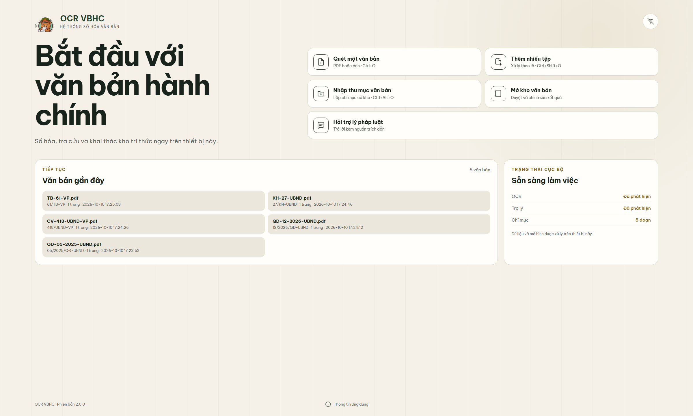
</picture>

<p align="center"><sub>Màn hình bắt đầu mở tức thì: số liệu kho được đọc ở chế độ chỉ-đọc trước khi nạp bất kỳ mô hình nào.<br>Ảnh tự đổi theo giao diện sáng/tối của GitHub.</sub></p>

---

## Vì sao có OCR VBHC

Một bộ phận văn thư nhận hàng chục văn bản giấy mỗi ngày. Mỗi văn bản cần nhập tay các thành phần
thể thức theo **Nghị định 30/2020/NĐ-CP** — số ký hiệu, ngày ban hành, cơ quan ban hành, trích yếu,
nơi nhận, người ký. Vài tháng sau, tìm lại *"quyết định nào đã thay thế quy chế cũ"* là cả một buổi lục
hồ sơ. Và văn bản của cơ quan nhà nước không được đưa lên dịch vụ đám mây để nhờ AI đọc hộ.

OCR VBHC đưa toàn bộ chuỗi việc đó về một máy trạm:

<table>
<tr>
<td width="33%" valign="top">

**Không rời máy**

Nhận dạng, lập chỉ mục, tìm kiếm và trả lời đều chạy cục bộ. Hai mô hình ngôn ngữ chỉ lắng nghe ở
`127.0.0.1`; trang giao diện web nhúng bị chặn mọi URL ngoài `file`/`qrc`/`data`; một bộ test canh giữ
điều đó.

</td>
<td width="33%" valign="top">

**Đúng thể thức NĐ 30**

Chandra OCR 2 đọc cả trang thành HTML giữ bố cục; bộ phân tích bóc ra 12 trường theo vị trí thể thức —
phần đầu ở trang 1, khối chữ ký neo theo "Nơi nhận". Mỗi lần sửa là một phiên bản mới, không ghi đè.

</td>
<td width="33%" valign="top">

**Trả lời có nguồn**

Trợ lý tra cứu bằng công cụ trên kho của bạn và chỉ giữ những nguồn nó thực sự trích dẫn. Bấm `[n]`
mở đúng văn bản, đúng trang để đối chiếu.

</td>
</tr>
</table>

---

## Giao diện

<p align="center">
  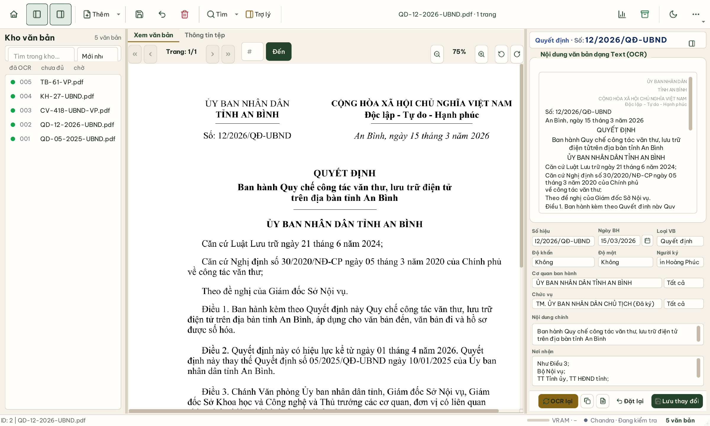
</p>
<p align="center"><sub><b>Không gian làm việc.</b> Kho văn bản bên trái, bản gốc ở giữa, 12 trường do Chandra OCR 2 bóc tách bên phải —<br>số ký hiệu <code>12/2026/QĐ-UBND</code>, ngày <code>15/03/2026</code>, loại, cơ quan, chức vụ, trích yếu, nơi nhận đều đúng với bản gốc.</sub></p>

<table>
<tr>
<td width="50%">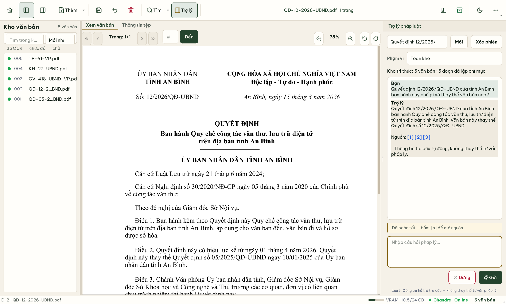</td>
<td width="50%">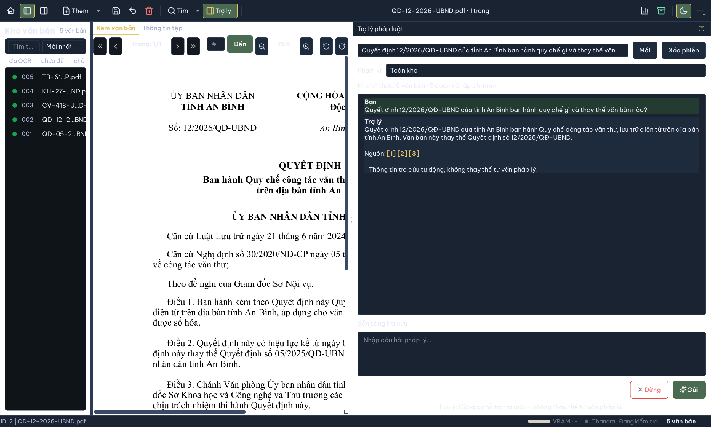</td>
</tr>
<tr>
<td colspan="2"><sub><b>Trợ lý pháp luật, sáng và tối.</b> Ảnh chụp nguyên trạng, không chỉnh sửa: câu trả lời nêu đúng quy chế được ban hành nhưng
ghi nhầm số hiệu văn bản bị thay thế — <code>12/2025</code> thay vì <code>05/2025</code>, như bản gốc bên trái vẫn ghi rõ. Đây chính là lý do mọi
câu trả lời đi kèm <code>[n]</code>: luôn bấm để đối chiếu. Xem <a href="#giới-hạn-đã-biết">Giới hạn đã biết</a>.</sub></td>
</tr>
<tr>
<td width="50%">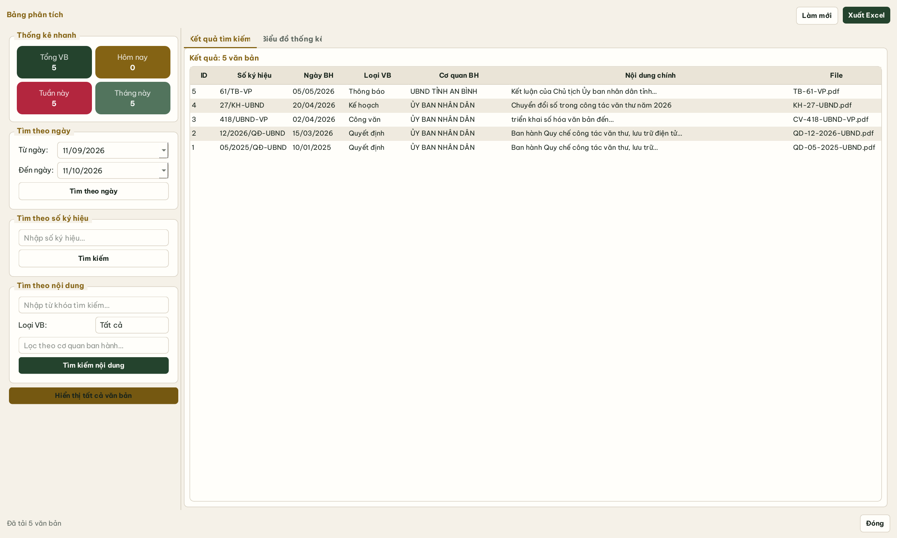</td>
<td width="50%">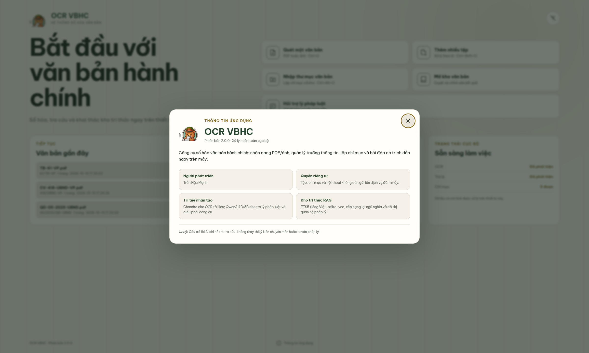</td>
</tr>
<tr>
<td><sub><b>Bảng phân tích.</b> Thống kê nhanh, tìm theo ngày, số ký hiệu, nội dung; biểu đồ theo độ khẩn, tháng và cơ quan; xuất Excel.</sub></td>
<td><sub><b>Thông tin ứng dụng.</b> Hộp thoại trên màn hình bắt đầu.</sub></td>
</tr>
</table>

<sub>Mọi văn bản trong ảnh là **văn bản mẫu hư cấu** soạn theo thể thức NĐ 30 — tỉnh An Bình không có thật, mỗi trang đều ghi
chú điều đó. Chúng được nhận dạng bằng chính ứng dụng: 5 văn bản trong 94 giây trên RTX 5090 Laptop, cơ sở dữ liệu riêng, không
dùng tới kho văn bản thật nào.</sub>

---

## Ca sử dụng

<p align="center">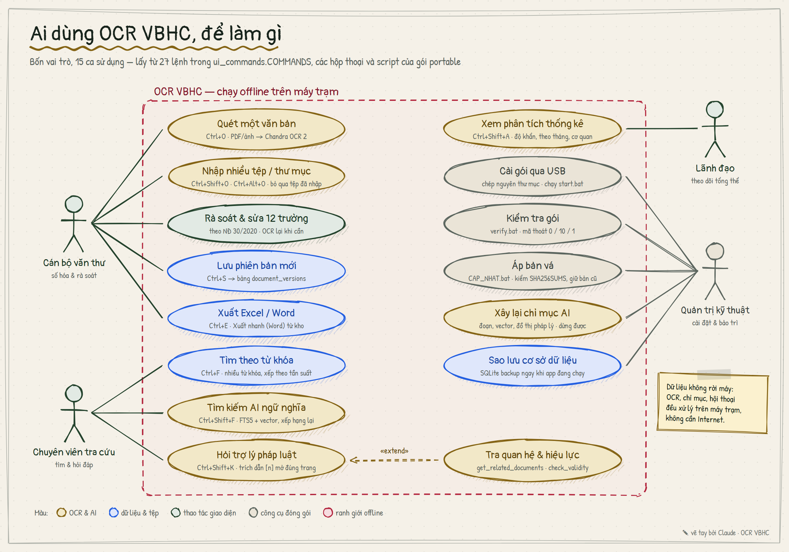</p>

Ứng dụng không có hệ thống phân quyền — một máy trạm, một người dùng. Bốn vai trò dưới đây là cách
công việc thực tế phân chia quanh nó.

### Cán bộ văn thư — số hóa văn bản đến

> **Bối cảnh.** Sáng thứ Hai, 40 văn bản đến được quét thành PDF vào một thư mục.

1. `Ctrl+Alt+O` **Nhập thư mục văn bản**. OCR chạy theo lô trong nền; trong lúc đó vẫn duyệt và sửa được các văn bản đã xong.
2. Mỗi văn bản được **lưu ngay khi nhận dạng xong**. Mất điện giữa chừng, lần nhập sau bỏ qua những tệp đã có trong kho và chạy tiếp phần còn lại.
3. Rà soát 12 trường bên phải, sửa chỗ sai, `Ctrl+S` **Lưu thay đổi** — tạo phiên bản mới, phiên bản cũ vẫn còn.
4. Cuối ngày, `Ctrl+E` **Xuất Excel** danh sách văn bản cùng các trường đã bóc tách.

> **Kết quả.** Không còn nhập tay số ký hiệu, ngày ban hành, trích yếu. Việc của văn thư chuyển từ *gõ lại* sang *kiểm lại*.

Cũng dùng: `Ctrl+O` quét một văn bản, `Ctrl+Shift+O` thêm nhiều tệp, nút **OCR lại** khi bản quét kém.

### Chuyên viên tra cứu — tìm văn bản và hỏi đáp

> **Bối cảnh.** Cần biết quy chế văn thư điện tử hiện hành của tỉnh và nó thay thế văn bản nào.

1. `Ctrl+F` **Tìm kiếm văn bản** theo từ khóa trên mọi trường; nhiều từ khóa cách nhau bằng dấu phẩy, xếp theo tần suất khớp.
2. `Ctrl+Shift+F` **Tìm kiếm AI ngữ nghĩa** khi không nhớ chữ chính xác: kết hợp BM25 tiếng Việt với tìm theo nghĩa, rồi xếp hạng lại.
3. `Ctrl+Shift+K` **Hỏi trợ lý pháp luật** bằng câu tự nhiên. Trợ lý tự gọi công cụ tra văn bản, đọc từng phần, tra quan hệ *thay thế / sửa đổi / căn cứ* và trạng thái hiệu lực.
4. Bấm `[n]` trong câu trả lời để mở đúng văn bản, đúng trang.

> **Kết quả.** Câu hỏi được trả lời bằng chính kho của cơ quan, kèm dẫn chiếu — nhưng **đối chiếu nguồn vẫn là bước bắt buộc** (xem giới hạn bên dưới).

### Lãnh đạo — nắm tình hình

`Ctrl+Shift+A` **Phân tích thống kê**: tổng số văn bản theo ngày, tuần, tháng; biểu đồ theo độ khẩn, theo tháng và theo cơ quan ban hành; tìm theo khoảng ngày, số ký hiệu hoặc nội dung; xuất báo cáo Excel.

### Quản trị kỹ thuật — triển khai và bảo trì trong mạng cách ly

1. Chép nguyên thư mục gói portable qua USB, chạy `start.bat`. Không cài Python, CUDA hay thư viện nào.
2. `verify.bat` kiểm tra gói: mã thoát `0` gói đầy đủ, `10` gói runtime hợp lệ còn chờ bộ mô hình, `1` gói hỏng.
3. `CAP_NHAT.bat <thư mục bản vá>` áp bản vá vài MB thay vì chép lại 23 GB — kiểm SHA-256, kiểm tương thích, sao lưu, tự khôi phục nếu lỗi giữa chừng.
4. **Xây lại chỉ mục AI** khi đổi mô hình nhúng hoặc sau khi nhập lượng lớn; **sao lưu** cơ sở dữ liệu ngay khi ứng dụng đang chạy.

---

## Kiến trúc

<p align="center">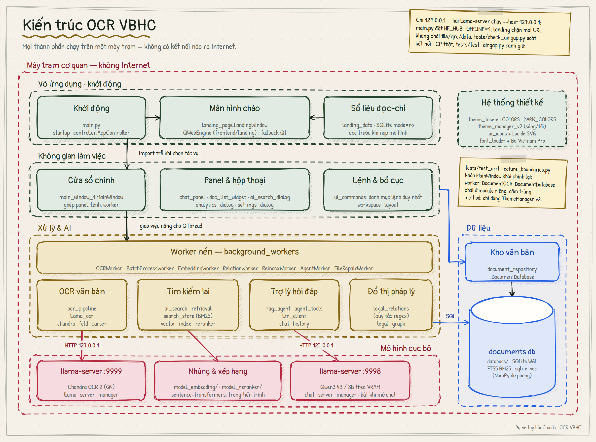</p>

Ứng dụng là một tiến trình PyQt5 cùng hai tiến trình `llama-server` cục bộ. Mọi thứ nằm trong một ranh
giới: máy trạm không có Internet.

| Tầng | Thành phần | Ghi chú |
|---|---|---|
| Khởi động | `main.py` → `AppController` → `LandingWindow` | Màn hình bắt đầu bằng HTML cục bộ qua QWebEngine; thiếu WebEngine thì tự chuyển sang bản Qt thuần |
| Không gian làm việc | `MainWindow`, các panel và hộp thoại | Lệnh, nhãn và phím tắt khai báo một lần trong `ui_commands.COMMANDS` |
| Xử lý & AI | OCR, tìm kiếm lai, đồ thị pháp lý, trợ lý | Việc nặng chạy trên `QThread`; giao diện không bao giờ chờ |
| Dữ liệu | `document_repository` → `documents.db` | SQLite WAL, FTS5, sqlite-vec trong cùng một tệp |
| Mô hình cục bộ | `:9999` Chandra OCR 2 · `:9998` Qwen3 · nhúng + ViRanker | Chỉ hai llama-server đi qua HTTP `127.0.0.1`; nhúng và xếp hạng chạy trong tiến trình |

`tests/test_architecture_boundaries.py` ngăn `main_window_1.py` phình lại thành god-object: worker, OCR và
lớp truy cập dữ liệu phải ở module riêng.

<details>
<summary><b>Khởi động: từ màn hình bắt đầu tới không gian làm việc</b></summary>
<br>
<p align="center">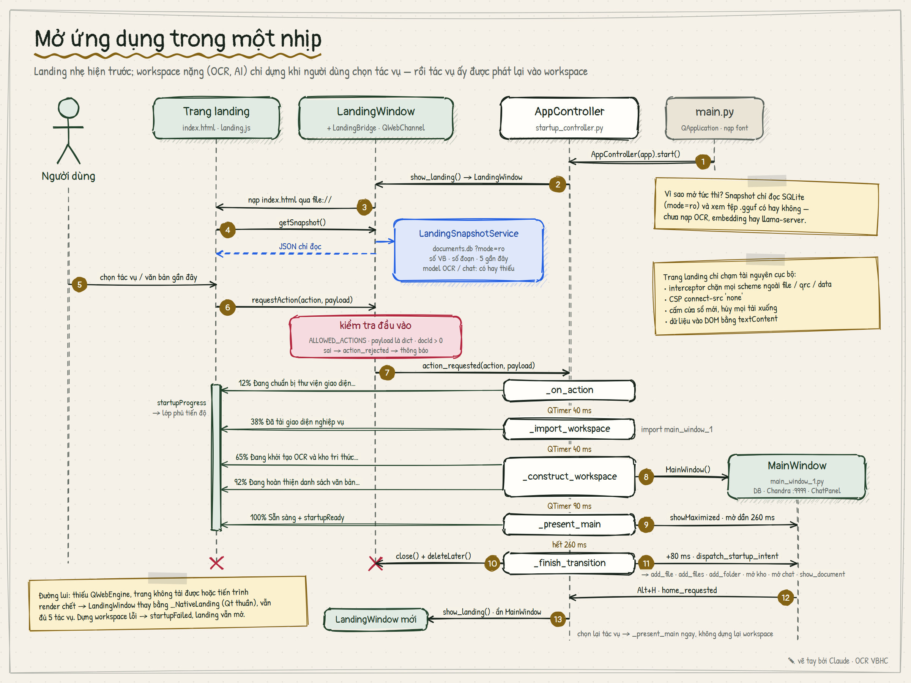</p>

Màn hình bắt đầu hiện ra trước khi bất kỳ mô hình nào được nạp. Không gian làm việc — nơi khởi động OCR
và kho tri thức — chỉ được dựng khi người dùng chọn một tác vụ, và tác vụ ấy được phát lại vào đó sau
khi chuyển cảnh. Trang web nhúng chỉ chạm tài nguyên cục bộ: CSP `connect-src 'none'`, interceptor chặn
mọi scheme lạ, mọi dữ liệu vào DOM qua `textContent`.
</details>

---

## Luồng số hóa

<p align="center">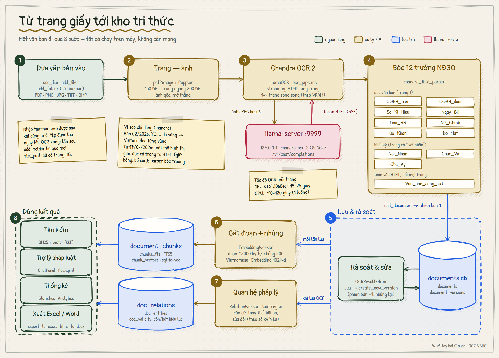</p>

Mười hai trường được bóc tách theo thể thức Nghị định 30/2020/NĐ-CP:

| Trường | Nghĩa | | Trường | Nghĩa |
|---|---|---|---|---|
| `CQBH_tren` | Cơ quan chủ quản | | `ND_Chinh` | Trích yếu nội dung |
| `CQBH_duoi` | Cơ quan ban hành | | `Noi_Nhan` | Nơi nhận |
| `So_Ki_Hieu` | Số, ký hiệu | | `Chuc_Vu` | Chức vụ người ký |
| `Ngay_BH` | Ngày ban hành | | `Chu_Ky` | Người ký |
| `Do_Khan` | Độ khẩn | | `Loai_VB` | Tên loại văn bản |
| `Do_Mat` | Độ mật | | `Van_ban_dang_txt` | Toàn văn |

---

## Trợ lý pháp luật

<p align="center">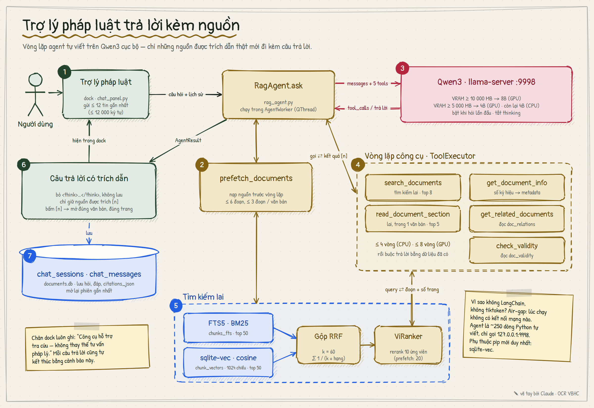</p>

- **Vòng lặp agent tự viết**, khoảng 250 dòng Python, không LangChain hay framework nào — vì một thư viện phải tải thêm tài nguyên lúc chạy là không chấp nhận được trong mạng cách ly.
- **Tìm kiếm lai**: FTS5 BM25 và sqlite-vec mỗi nhánh lấy 50 kết quả, gộp bằng Reciprocal Rank Fusion (k = 60), rồi ViRanker xếp hạng lại.
- **Mô hình theo phần cứng**: VRAM ≥ 10 GB dùng Qwen3-8B, ≥ 5 GB dùng Qwen3-4B, còn lại chạy 4B trên CPU. Tối đa 8 vòng công cụ trên GPU, 4 trên CPU.
- **Kỷ luật trích dẫn**: phần suy luận nội bộ bị bỏ, không lưu; chỉ nguồn được trích dẫn thật mới đi kèm câu trả lời; chỉ 12 tin nhắn gần nhất làm ngữ cảnh.

<details>
<summary><b>Mô hình dữ liệu: một tệp SQLite, ba cách tìm</b></summary>
<br>
<p align="center">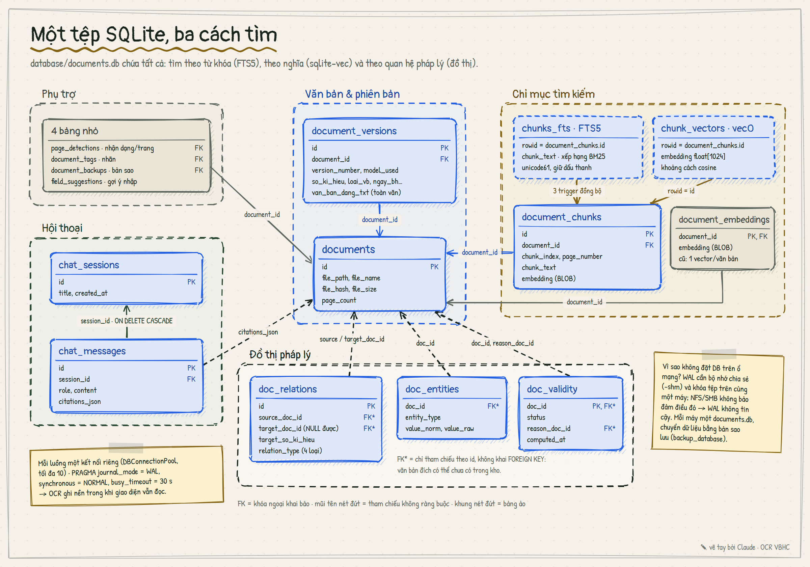</p>

Văn bản, phiên bản, chỉ mục từ khóa (FTS5), chỉ mục vector (sqlite-vec), đồ thị pháp lý và hội thoại
nằm chung trong `database/documents.db`. Mỗi luồng một kết nối, chế độ WAL để OCR ghi nền trong khi
giao diện vẫn đọc. Không đặt tệp này trên ổ mạng: WAL cần bộ nhớ chia sẻ trên cùng một máy.
</details>

---

## Phát hành và cập nhật xuyên air-gap

<p align="center">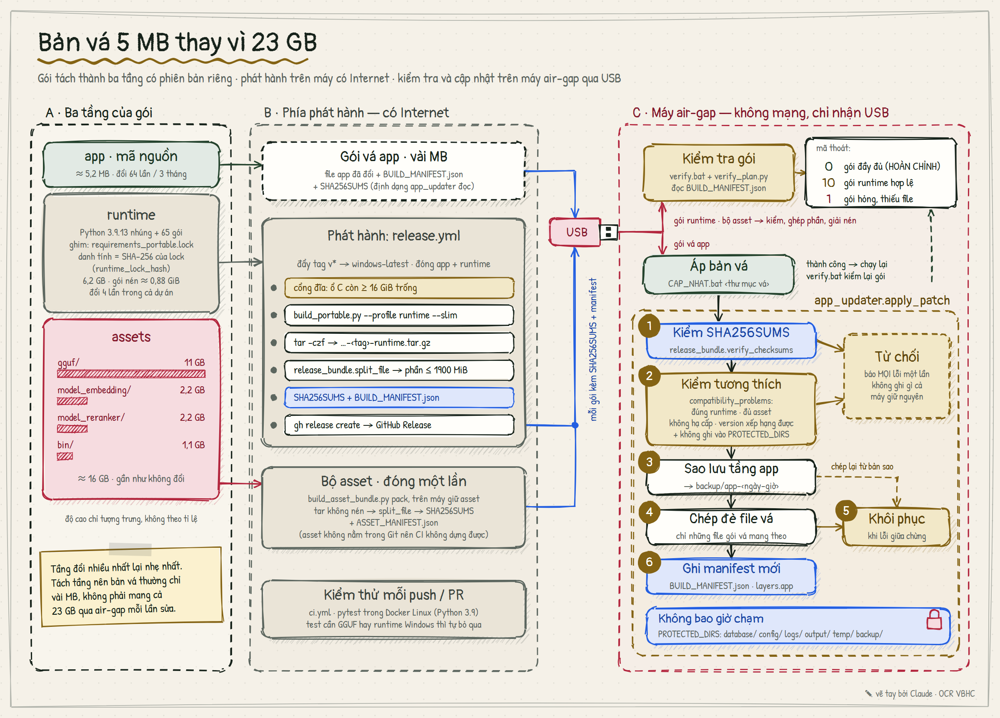</p>

Gói đầy đủ nặng khoảng 23 GB, nhưng ba phần của nó thay đổi với nhịp chênh nhau hàng nghìn lần:

| Tầng | Kích thước | Nhịp thay đổi | Danh tính |
|---|---|---|---|
| **app** — mã nguồn | ~5 MB | hằng tuần | tag phát hành |
| **runtime** — Python 3.9 nhúng + thư viện | 0,88 GiB nén (bản CPU) | hiếm khi — 4 lần trong cả lịch sử dự án | SHA-256 của `requirements_portable.lock` |
| **assets** — mô hình và llama.cpp | ~16 GB | gần như không đổi | manifest riêng |

`BUILD_MANIFEST.json` ghi ba tầng độc lập; bản vá khai báo runtime nó được dựng trên đó. Trên máy cách ly,
`app_updater` kiểm SHA-256 và tính tương thích **trước lần ghi đầu tiên**, từ chối hạ cấp, sao lưu phiên
bản cũ, khôi phục khi lỗi giữa chừng, và không bao giờ chạm `database/`, `config/`, `logs/`, `output/`.

---

## Cấu trúc thư mục

```text
ocr-vbhc/
├── main.py, startup_controller.py         khởi động và chuyển cảnh
├── landing_page.py, landing_data.py       màn hình bắt đầu (QWebEngine + bản Qt thuần)
├── frontend/landing/                      HTML · CSS · JS của màn hình bắt đầu, chỉ tài nguyên cục bộ
├── main_window_1.py                       không gian làm việc
├── chat_panel.py, analytics_dialog.py,
│   ai_search_dialog.py, settings_dialog.py,
│   doc_list_widget.py, …                  panel và hộp thoại
├── ocr_pipeline.py, llama_ocr.py,
│   pdf_rendering.py, chandra_field_parser.py   OCR và bóc tách 12 trường
├── document_repository.py                 SQLite: văn bản, phiên bản, sao lưu
├── ai_search.py, retrieval.py,
│   reranker.py, vector_index.py,
│   search_store.py                        nhúng vector, tìm kiếm lai, xếp hạng lại
├── legal_relations.py, legal_graph.py     quan hệ pháp lý và hiệu lực
├── rag_agent.py, agent_tools.py,
│   llm_client.py, chat_history.py,
│   chat_server_manager.py                 trợ lý pháp luật
├── background_workers.py                  worker nền của pipeline
├── theme_tokens.py, theme_manager_v2.py,
│   theme.qss, theme_dark.qss, ui_icons.py,
│   font_loader.py, ui_commands.py         hệ thống thiết kế và danh mục lệnh
├── build_portable.py, build_asset_bundle.py,
│   release_bundle.py, app_updater.py,
│   verify_plan.py                         đóng gói, phát hành, cập nhật
├── start.bat, verify.bat, CAP_NHAT.bat    lối vào cho người vận hành
├── requirements_portable.txt / .lock      phụ thuộc khai báo / ghim chính xác
├── assets/, icons/lucide/                 font Be Vietnam Pro, biểu tượng
├── tests/                                 376 test
├── docker/, .github/workflows/            CI Linux và quy trình phát hành
├── tools/check_airgap.py                  soát kết nối mạng thật lúc chạy
└── docs/
    ├── diagrams/                          sơ đồ vẽ tay (HTML + PNG) và bộ kit vẽ
    ├── screenshots/
    └── DEVELOPMENT.md                     hướng dẫn cho người phát triển
```

`runtime/`, `gguf/`, `model_embedding/`, `model_reranker/`, `bin/`, `tools/poppler/` và `database/` không
nằm trong Git — chúng là phần nặng của gói portable hoặc dữ liệu của người dùng.

---

## Công nghệ

| | |
|---|---|
| **Giao diện** | PyQt5 5.15 · QtWebEngine · GSAP · Be Vietnam Pro · Lucide |
| **OCR** | [Chandra OCR 2](https://github.com/datalab-to/chandra) Q4_K_M + mmproj qua [llama.cpp](https://github.com/ggml-org/llama.cpp) |
| **Ngôn ngữ** | [Qwen3](https://github.com/QwenLM/Qwen3) 8B / 4B-Instruct-2507, Q4_K_M |
| **Nhúng vector** | Vietnamese_Embedding (tinh chỉnh từ BAAI/bge-m3, 1024 chiều) qua sentence-transformers |
| **Xếp hạng lại** | ViRanker (cross-encoder) |
| **Lưu trữ** | SQLite WAL · FTS5 · [sqlite-vec](https://github.com/asg017/sqlite-vec) |
| **Đóng gói** | Python 3.9 nhúng · PyTorch · Docker (CI) · GitHub Actions |

Trọng số mô hình không nằm trong repo và tuân theo giấy phép của từng dự án gốc.

---

## Bắt đầu

**Dùng ứng dụng.** Nhận gói portable đã đóng sẵn, chép nguyên thư mục vào máy Windows 10/11 x64 (gói khoảng
23 GB, 8 GB RAM; GPU NVIDIA tùy chọn nhưng nhanh hơn nhiều), chạy `start.bat`. Chi tiết vận hành ở [PORTABLE_README.md](PORTABLE_README.md).

**Dựng gói từ mã nguồn.** Repo chỉ chứa mã. Tầng runtime dựng được từ Internet:

```bash
python build_portable.py --profile runtime --slim
```

Tầng mô hình phải được cung cấp riêng (`gguf/`, `model_embedding/`, `model_reranker/`, `bin/`) theo bố
cục khai báo trong `app_config.py`; khi đủ, `--profile full` dựng gói hoàn chỉnh và từ chối dựng nếu thiếu.

**Chạy test** — ở bất kỳ máy nào có Docker, không cần mô hình:

```bash
docker build -f docker/Dockerfile.ci -t ocr-vbhc-ci . && docker run --rm ocr-vbhc-ci
```

Hướng dẫn cho người phát triển — chạy test bằng Python nhúng, quy ước đóng góp — ở [docs/DEVELOPMENT.md](docs/DEVELOPMENT.md).

---

## Chất lượng

- **376 test tự động**; CI chạy toàn bộ trong Docker Linux trên mỗi lần push.
- **Ràng buộc kiến trúc** bằng test: module, lệnh, tài nguyên đóng gói, kết nối mạng.
- **Tiếp cận WCAG AA** cho cả theme sáng và tối, kiểm theo vai trò của từng màu — chữ hay nền.
- **Air-gap được kiểm, không chỉ hứa**: `tests/test_airgap.py` và `tools/check_airgap.py` soát mọi kết nối TCP thật của ứng dụng lúc chạy.
- **Gói không thể âm thầm thiếu**: dựng `--profile full` mà thiếu mô hình sẽ dừng lại, không tạo ra gói trông như hoàn chỉnh.

## Giới hạn đã biết

Những điểm dưới đây được ghi nhận khi chạy thật ứng dụng để chụp các ảnh trên.

- **Trợ lý có thể sai ở con số.** Với 5 văn bản mẫu và bốn câu hỏi thử: ba câu nắm đúng ý chính nhưng sai một con số — ngày hiệu lực, hạn hoàn thành, số hiệu văn bản bị thay thế; câu còn lại trả lời *"không xác định được hiệu lực"* dù đồ thị pháp lý đã ghi nhận văn bản đó hết hiệu lực. Luôn bấm `[n]` đối chiếu bản gốc trước khi dùng.
- **Văn bản mới chưa vào chỉ mục vector ngay.** Sau khi OCR, văn bản tìm được bằng từ khóa tức thì, nhưng nhánh tìm theo nghĩa chỉ thấy nó sau lần đồng bộ kế tiếp — khi mở **Tìm kiếm AI** hoặc **Xây lại chỉ mục AI**.
- **Đổi theme khi đang chạy** để lại vài nhãn chưa đổi màu; khởi động lại thì hiển thị đúng.
- **GPU thế hệ Blackwell** chưa được PyTorch đóng kèm hỗ trợ, nên mô hình nhúng chạy CPU trên các máy này; OCR và trợ lý qua llama.cpp vẫn dùng GPU.
- **Một máy, một người dùng.** Không có đăng nhập hay phân quyền; cơ sở dữ liệu không chia sẻ được qua ổ mạng.

---

## Giấy phép

Chưa gắn giấy phép mã nguồn mở — bảo lưu mọi quyền. Thành phần bên thứ ba (GSAP, Be Vietnam Pro, Lucide)
được ghi ở [THIRD_PARTY_NOTICES.md](THIRD_PARTY_NOTICES.md).

<br>

<div align="center">
<sub>Các sơ đồ trong README được những agent Claude vẽ tay bằng <a href="https://roughjs.com">rough.js</a>, đối chiếu từng chi tiết với mã nguồn.<br>
Bản gốc HTML nằm ở <a href="docs/diagrams">docs/diagrams</a>; vẽ lại bằng <code>python docs/diagrams/render.py</code>.</sub>
</div>
